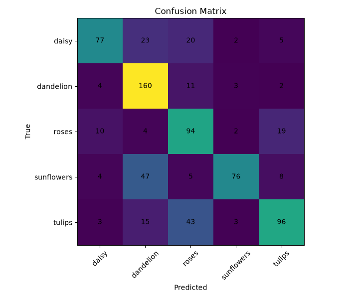

# Flower Classification 🌸

基于 Python 和 PyTorch 实现的五类花卉图像分类项目。项目采用手动实现的 Residual Block（残差块）和自定义 ResNet 网络，完成数据集准备、数据分析、模型训练、模型评估和单张图片预测。

## 1. 项目简介

本项目识别以下五种花卉：

- daisy：雏菊
- dandelion：蒲公英
- roses：玫瑰
- sunflowers：向日葵
- tulips：郁金香

项目主要流程：

1. 下载并准备花卉数据集
2. 将数据集划分为训练集和验证集
3. 使用 NumPy、Pandas 和 Matplotlib 分析数据
4. 使用 PyTorch 构建 Dataset 和 DataLoader
5. 手动实现残差块并搭建自定义 ResNet
6. 使用 GPU 训练模型并保存最佳权重
7. 评估模型并生成混淆矩阵
8. 对单张花卉图片进行分类预测

## 2. 项目结构

```text
flower-classification/
├── data/
│   ├── flower_photos/
│   └── split/
│       ├── train/
│       └── val/
├── docs/
├── models/
│   └── best_model.pth
├── results/
│   ├── accuracy_curve.png
│   ├── class_distribution.csv
│   ├── class_distribution.png
│   ├── confusion_matrix.png
│   └── loss_curve.png
├── src/
│   ├── analyze_data.py
│   ├── dataset.py
│   ├── download_data.py
│   ├── evaluate.py
│   ├── model.py
│   ├── predict.py
│   ├── prepare_data.py
│   ├── test_dataloader.py
│   ├── test_model.py
│   ├── test_resnet.py
│   └── train.py
├── .gitignore
├── requirements.txt
└── README.md
```

说明：`data/`、`models/` 和 `.venv/` 等本地文件通常由 `.gitignore` 排除在 Git 版本管理之外。运行项目之前，需要在本地准备数据集；训练后生成模型权重。

## 3. 环境配置

项目开发环境：

- 操作系统：Windows
- Python：3.11.9
- 深度学习框架：PyTorch
- 计算设备：支持 CUDA 的 NVIDIA GPU

建议使用独立虚拟环境。

在项目根目录执行：

```powershell
python -m venv .venv
.\.venv\Scripts\Activate.ps1
python -m pip install --upgrade pip
pip install -r requirements.txt
```

如果 PowerShell 不允许激活脚本运行，也可以直接使用虚拟环境中的 Python：

```powershell
.\.venv\Scripts\python.exe -m pip install -r requirements.txt
```

检查 PyTorch 和 CUDA：

```powershell
python -c "import torch; print('PyTorch:', torch.__version__); print('CUDA available:', torch.cuda.is_available())"
```

项目依赖以 `requirements.txt` 为准。PyTorch 与 CUDA 的实际兼容性取决于安装的 PyTorch 构建和本机环境。

## 4. 数据集准备

### 下载数据集

```powershell
python src/download_data.py
```

脚本会检查数据集是否已经存在，避免重复下载。

### 划分训练集和验证集

```powershell
python src/prepare_data.py
```

该脚本用于按约 8:2 的比例划分数据集。当前项目已经完成划分；脚本会在目标目录已存在时停止，以避免覆盖已有数据。

### 当前数据统计

| 类别 | 训练集 | 验证集 | 总数 |
|---|---:|---:|---:|
| daisy | 506 | 127 | 633 |
| dandelion | 718 | 180 | 898 |
| roses | 512 | 129 | 641 |
| sunflowers | 559 | 140 | 699 |
| tulips | 639 | 160 | 799 |
| **合计** | **2934** | **736** | **3670** |

训练集共 2934 张，验证集共 736 张。

## 5. 数据分析

执行：

```powershell
python src/analyze_data.py
```

分析脚本使用 NumPy、Pandas 和 Matplotlib，对各类别的训练集与验证集图片数量进行统计，并生成以下文件：

- `results/class_distribution.csv`：类别数量统计表
- `results/class_distribution.png`：类别分布图

当前数据集共有 3670 张图片，五个类别的样本数量并不完全相同。后续可以结合分类准确率与混淆矩阵，进一步分析不同类别的识别表现。

## 6. 模型结构

项目采用手动实现的简化版 ResNet，而不是直接调用 torchvision 中的预训练 ResNet。

网络主要包括：

1. 卷积层
2. 多个 Residual Block
3. 自适应平均池化层
4. 全连接分类层

### Residual Block

残差块主要包含：

- 两次 3×3 卷积
- Batch Normalization
- ReLU 激活函数
- Shortcut 跳跃连接

残差连接使输入特征可以通过捷径路径与卷积结果相加。对于需要改变通道数或进行下采样的残差块，使用相应的维度变换以保证张量能够相加。

当前模型参数量为 **695,973**，最终输出五个类别对应的分数。

## 7. 模型训练

执行：

```powershell
python src/train.py
```

训练流程包括：

1. 使用 Dataset 和 DataLoader 加载数据
2. 将图片输入自定义 ResNet
3. 计算分类损失
4. 使用优化器更新模型参数
5. 在验证集上评估模型
6. 保存表现最佳的模型权重

训练结果文件：

- `results/loss_curve.png`：损失曲线
- `results/accuracy_curve.png`：准确率曲线
- `models/best_model.pth`：最佳模型权重

如果模型权重文件不存在，需要先完成训练，再执行模型评估或图片预测。

## 8. 模型评估

执行：

```powershell
python src/evaluate.py
```

评估脚本输出总体准确率和各类别准确率，并生成混淆矩阵。

当前记录的验证集结果：

- 总体准确率：**68.34%**
- daisy：60.63%
- dandelion：88.89%
- roses：72.87%
- sunflowers：54.29%
- tulips：60.00%

### 训练损失曲线


### 准确率曲线


### 混淆矩阵



以上结果来自当前项目的已有运行记录。模型仍有改进空间，尤其是不同类别之间的识别表现存在差异。

## 9. 单张图片预测

运行：

```powershell
python src/predict.py
```

程序会提示输入图片路径。输入本地花卉图片的完整路径后，程序将自动加载训练好的模型并输出预测类别和置信度。

示例：

```text
请输入图片路径:
C:\path\to\flower.jpg
运行设备: cuda
预测类别: dandelion
置信度: 56.20%
```

以上预测输出仅作为运行格式示例，实际类别与置信度取决于输入图片。模型预测可能出现错误，置信度也不代表分类正确的保证。

## 10. 测试

项目包含以下测试脚本：

```powershell
python src/test_dataloader.py
python src/test_model.py
python src/test_resnet.py
```

当前测试记录表明：

- DataLoader 能够读取图片并生成批次张量
- 残差块在不同维度配置下可以完成前向传播
- 自定义 ResNet 能够接收 `[8, 3, 224, 224]` 的输入并输出 `[8, 5]` 的结果
- 测试环境能够使用 CUDA

这些测试用于验证数据加载和模型基本结构，不代表模型在所有情况下都没有问题。

## 11. 技术栈

- Python
- PyTorch
- torchvision
- NumPy
- Pandas
- Matplotlib
- Pillow
- CUDA
- Git
- GitHub

## 12. 项目收获与后续优化

通过本项目，学习并实践了：

- 深度学习图像分类的基本流程
- Dataset 与 DataLoader 的使用
- 残差连接和自定义 ResNet 的实现
- GPU 训练、模型保存与加载
- 分类指标、训练曲线和混淆矩阵的分析
- Git 版本管理与 GitHub 项目维护

后续可以从以下方面继续改进：

- 尝试更合理的数据增强
- 调整网络结构和训练超参数
- 分析容易混淆的类别
- 比较自定义网络与迁移学习方法的效果
- 开发简单的图形界面或 Web 预测页面

## 13. GitHub 仓库

项目地址：

https://github.com/yixingd887-design/flower-classification

## 14. 作者

戴永华