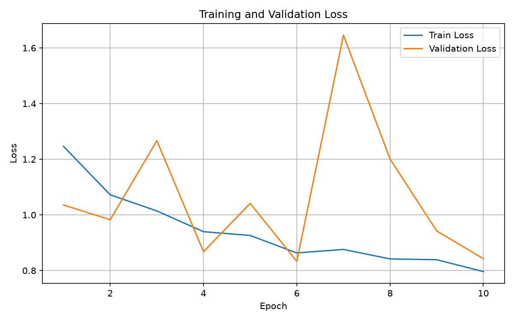
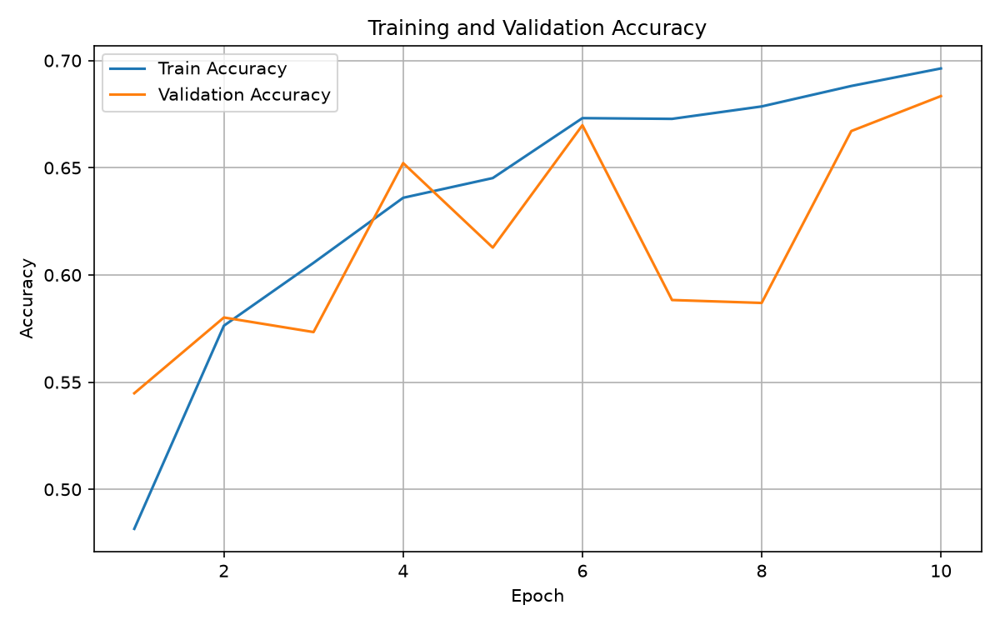

# Flower Classification 🌸

基于 PyTorch 实现的花卉图像分类项目。

本项目使用自定义 ResNet 网络，实现对五种花卉图像的自动分类：

- daisy（雏菊）
- dandelion（蒲公英）
- roses（玫瑰）
- sunflowers（向日葵）
- tulips（郁金香）

## 项目简介

本项目完整实现了一个深度学习图像分类流程：

- 数据集准备与划分
- 图像预处理
- Dataset 与 DataLoader 构建
- Residual Block 残差块实现
- 自定义 ResNet 网络搭建
- GPU 模型训练
- 模型保存与加载
- 单张图片预测

项目目标：

输入一张花卉图片，通过深度学习模型自动判断所属类别。

## 项目结构

flower-classification

├── data
│   └── split
│       ├── train
│       └── val

├── models
│   └── best_model.pth

├── results
│   ├── loss_curve.png
│   └── accuracy_curve.png

├── src
│   ├── dataset.py
│   ├── model.py
│   ├── train.py
│   └── predict.py

├── docs

├── .gitignore

└── README.md
## 环境配置

Python:

Python 3.x

主要依赖：

- PyTorch
- torchvision
- Pillow
- matplotlib

安装：

pip install torch torchvision pillow matplotlib

## 模型结构

本项目采用简化版 ResNet。

网络流程：

输入图片

↓

卷积层 Conv2d

↓

Residual Blocks

↓

Adaptive Average Pooling

↓

Fully Connected Layer

↓

5分类输出

## Residual Block

每个残差块包含：

- 两次 3×3 卷积
- Batch Normalization
- ReLU 激活函数
- Shortcut 跳跃连接

残差结构：

输入

↓

卷积

↓

卷积

↓

与Shortcut相加

↓

ReLU输出
## 数据集

类别：

- daisy
- dandelion
- roses
- sunflowers
- tulips

数据数量：

训练集：

2934 张

验证集：

736 张

输入尺寸：

224 × 224

## 模型训练

训练设备：

CUDA GPU

训练命令：

python src/train.py

训练过程：

Dataset

↓

DataLoader

↓

ResNet

↓

Loss计算

↓

参数更新

## 实验结果

最佳验证准确率：

70.92%

训练曲线：

### Loss变化

### Accuracy变化

模型参数量：

695973

模型保存：

models/best_model.pth

## 图片预测

运行：

python src/predict.py

示例输出：

运行设备: cuda

预测类别: roses

置信度: 86.66%
## 技术栈

- Python
- PyTorch
- torchvision
- CUDA
- Git
- GitHub

## 项目收获

通过本项目学习：

- 深度学习图像分类流程
- CNN网络设计
- ResNet残差思想
- PyTorch训练流程
- GPU加速训练
- 模型部署预测

## 后续优化方向

- 数据增强提高模型泛化能力
- 使用预训练 ResNet18
- 增加混淆矩阵分析
- 增加 Web 在线预测界面

## Author

戴永华

GitHub:

https://github.com/yixingd887-design